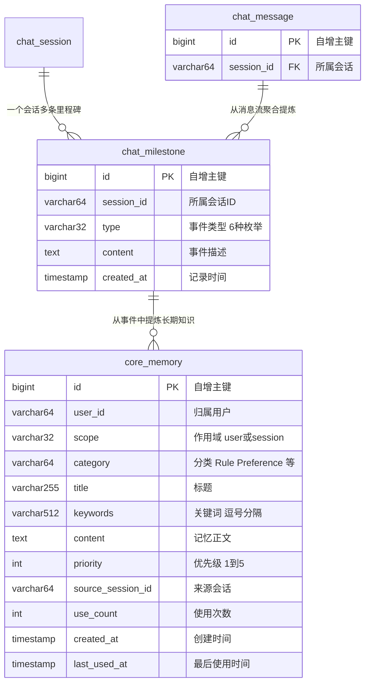

# 《WaLiCode - AI Coding 智能编码》第1-3节：持久化，里程碑与核心记忆

作者：小傅哥
 博客：[https://bugstack.cn](https://bugstack.cn)
 项目：[https://t.zsxq.com/DhmC6](https://t.zsxq.com/DhmC6)

> 沉淀、分享、成长，让自己和他人都能有所知有所获！😄

大家好，我是技术UP主小傅哥。

「会话」、「消息」，已经在前面章节落到库里了。而这些落库的数据，核心的目的在于怎么在后续的对话中，高质量的让 LLM 可靠的运行。而不是说，把全部历史对话都塞给每次请求 LLM 的上下文里。那么就需要考虑，要把一些关键事件、信息密度高（类似纪要）、长期知识、带关键词的索引等，通过`里程碑`和`核心记忆`存储起来。

## 一、本章诉求

设计`里程碑`和`核心记忆`库表，提供 po、dao、以及 domain 领域层的仓储调用操作；

| 类型 | 库表 | 说明 |
|------|------|------|
| 已有 | `chat_session` | 会话元数据，1-1 建立 |
| 已有 | `chat_message` | 每一轮对话原文，1-2 接入写路径 |
| 新增 | `chat_milestone` | 里程碑表 |
| 新增 | `core_memory` | 核心记忆表 |

表关系；

- 里程碑是**会话级**的：记录一个会话里的关键事件（任务切换、用户纠正、关键决策……），随会话的生命周期存在；
- 核心记忆是**用户级**的：记录从这个用户身上学到的长期有效的知识（偏好、规则、纠正、决策、事实），跨会话复用。

综上，两者的演化方向是：**消息 → 聚合出里程碑 → 提炼成核心记忆**，越往上越精炼、越长期。到后面做上下文工程时，这两类数据是拼装 Prompt 的重要素材（其实这些东西在 walissh 也有涉及了，为了让小伙伴在没有学习过 walissh 也能上手 walicode 这里也会着重介绍）。

那么，对应到工程上，本节要做的事：

1. `schema.sql` 追加 `chat_milestone`、`core_memory` 两张表（在 dev-ops/mysql 下提供库表语句）；
2. 里程碑是会话级数据，直接在既有的 `IChatHistoryRepository` 上扩展两个方法（存里程碑、查里程碑），不另起炉灶；
3. 核心记忆是跨会话的用户级数据，独立成 `ICoreMemoryRepository` + `CoreMemoryRepository`，实现关键词匹配、fallback、使用统计、冷记忆淘汰；

## 二、库表设计

两张表一个显著的特点是字段都不多，但每个字段都有用途，而且都往"后面要怎么查"上想了一步。

**里程碑表 chat_milestone**：结构非常简单，就是"哪个会话、什么类型、发生了什么"。`type` 存 6 种事件类型的枚举名：

- `TASK_CHANGE` 任务变更（比如从需求分析切到编码）
- `TASK_COMPLETE` 任务完成
- `USER_CORRECTION` 用户纠正（用户明确指出 AI 的错误，这是高价值记忆，避免重复犯错）
- `ERROR` 错误
- `DECISION` 决策（比如"选用 H2 作为课程默认库"）
- `FILE_SWITCH` 文件切换

为什么要分类型？为的是后面拼上下文时，不同目的要取不同事件——回放任务进度只看 TASK_CHANGE/TASK_COMPLETE，想避免重复犯错就看 USER_CORRECTION/ERROR。入库时把类型标好，查询时才能按需过滤。

**核心记忆表 core_memory**：字段比里程碑多不少，重点四个：

- `keywords`：相关性匹配全靠它。存的时候就预置好"代码风格、java、缩进"这类词，查询时和用户输入的关键词求交集。这是本节检索方案的基石——不引入向量库，用 LIKE 匹配先跑起来，简单、可解释、够用；
- `priority`（1-5）：优先级。SQL 里会限定 `priority >= 3` 的记忆才参与关键词命中，低优先级的记忆不掺和检索，省得噪声干扰；
- `use_count` / `last_used_at`：使用统计。每命中一次就 +1、刷新时间，这是淘汰机制的判断依据——越常用的记忆越不容易被删；
- `source_session_id`：追溯这条知识从哪次对话提炼来的，出问题时能回查源头。

`user_id` 上建了索引，因为核心记忆最频繁的访问路径就是"按用户查相关记忆"。
